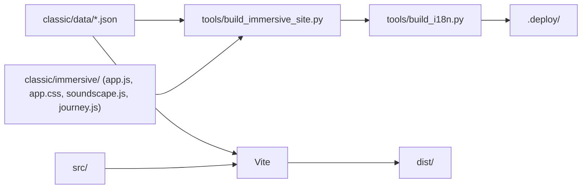

# naroa.online

Portfolio de la artista Naroa Gutiérrez Gil. El dominio canónico es `https://naroagutierrezgil.com`.

Las reglas de trabajo y las invariantes del sitio están en [AGENTS.md](AGENTS.md). Si este archivo y `AGENTS.md` se contradicen, manda `AGENTS.md`.

## Dos superficies

| | El museo | El lab |
| --- | --- | --- |
| Qué es | El portfolio inmersivo: la web pública | Una galería 3D experimental (SPA) |
| Fuentes | `classic/data/` y `classic/immersive/` | `src/` |
| Se compila con | `tools/build_immersive_site.py` (Python y Pillow) | Vite (React, TypeScript, Three.js) |
| Salida | `.deploy/` | `dist/` |

El museo es un sitio estático: el generador lee el catálogo revisado, escribe una página por ruta, optimiza las imágenes y, al final, `tools/build_i18n.py` crea las copias en inglés (`/en/`) y euskera (`/eu/`). No hay servidor ni llamadas de red durante la compilación.

Las dos superficies comparten el catálogo de obras. El control `tools/check_catalog_sources.py` falla si `classic/data/catalogo.json`, `classic/data/journey.json` y `src/artworks.ts` dejan de coincidir.



## Requisitos

- Node 22 o posterior y `pnpm` (el repositorio lleva `pnpm-lock.yaml`).
- Python 3 con Pillow: `python3 -m pip install -r requirements.txt`. `c2pa-python` solo hace falta para firmar las fotos (AGENTS.md §12).

## Comandos

```bash
pnpm install
```

| Comando | Qué hace |
| --- | --- |
| `pnpm dev` | Servidor de desarrollo del lab (Vite) |
| `pnpm run build` | Compila el lab en `dist/` |
| `pnpm run build:site` | Genera el museo en `.deploy/`. Tarda varios minutos: optimiza todas las imágenes |
| `pnpm run test:sources` | Comprueba la paridad de las fuentes del catálogo, sin compilar |
| `pnpm run test:site` | Fuentes del catálogo, sitio generado y suite JSDOM. Lee `.deploy/`: primero hay que compilar |
| `pnpm run test:lint` | Lint con oxlint |
| `pnpm test` | Lint, tipos y `test:site` |
| `./deploy.sh --build-only` | Compila las dos superficies y pasa los controles, sin publicar |

Los scripts y hojas de estilo del museo salen con un hash en el nombre, así que un cambio en `classic/immersive/` no se ve hasta recompilar.

## Despliegue

- **Subir es desplegar.** Cada `git push` a `origin/master` lanza un despliegue de producción en Vercel, que compila con `./deploy.sh --build-only` y publica `.deploy/` (`vercel.json`).
- `./deploy.sh` sin opciones publica desde esta máquina: sube `.deploy/` y `dist/` a Cloudflare Pages con `wrangler` y después publica `.deploy/` en producción de Vercel (`vercel deploy --prebuilt --prod`). `./deploy.sh --help` lista las opciones.
- El estado de un despliegue se mira con `npx vercel ls` y `npx vercel inspect <url>`, no sondeando el dominio público.

## Carpetas heredadas

`live-site/`, `museum/` y `tools/build_museum_site.py` son versiones anteriores del sitio. No intervienen en la compilación ni en el despliegue actuales.

## Licencia y seguridad

Todos los derechos reservados; las condiciones están en [LICENSE.md](LICENSE.md). Para avisos de seguridad, [SECURITY.md](SECURITY.md).
