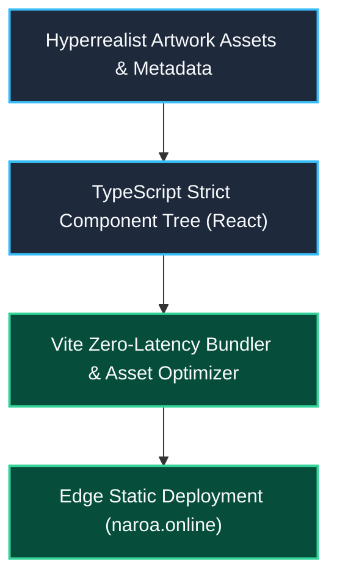

# 🌐 Naroa Online (`naroa.online`)

> **High-Performance Visual Art & Hyperrealist Portfolio Platform Engineered with React, TypeScript & Vite.**

[](https://github.com/borjamoskv/naroa.online/actions)
[](./LICENSE)


Modern web platform built on the **React + TypeScript + Vite** stack, engineered to enforce a fast, deterministic, and responsive visual gallery experience.

---

## ⚡ Quickstart & Installation

To execute the project in your local environment:

```bash
git clone https://github.com/borjamoskv/naroa.online.git
cd naroa.online
npm install
npm run dev
```

The instance will be exposed at `http://localhost:5173`.

---

## 🧬 Architecture & Core Features



- **Extreme Performance:** Built on Vite for zero-latency development load times and highly optimized production builds.
- **Type Safety:** Robust runtime-error-free code guaranteed by strict TypeScript checks.
- **Modular Architecture:** Reusable React components for streamlined maintenance and responsive gallery rendering.

---

## 🛠️ Available Commands

- `npm run dev`: Initializes the local development server.
- `npm run build`: Compiles the project for production deployment.
- `npm run preview`: Executes a local preview of the production build.
- `npm run lint`: Triggers the linter (`ESLint`) to enforce code quality metrics.

---

## 🛡️ License & Security

Released under the **MIT License** (`LICENSE`). For contributions or security disclosures, please follow `CONTRIBUTING.md` and `SECURITY.md`.

---
*Maintained by [borjamoskv](https://github.com/borjamoskv).*
